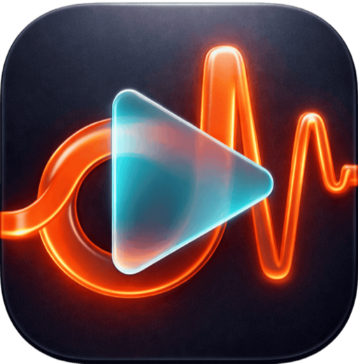
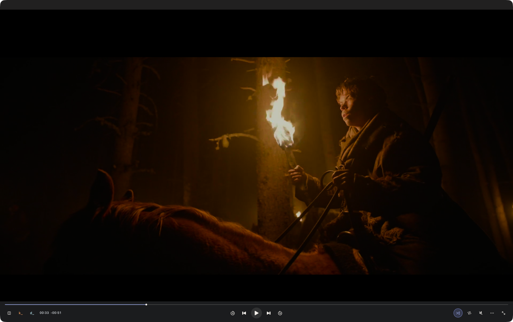
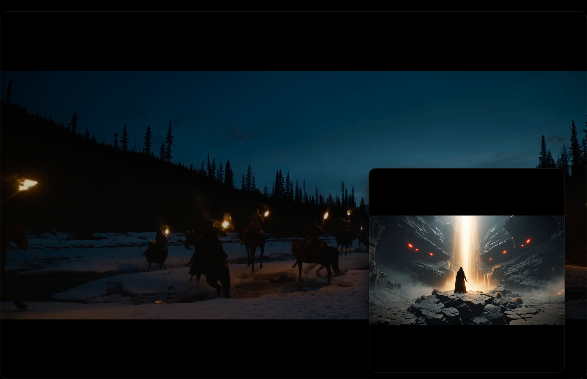
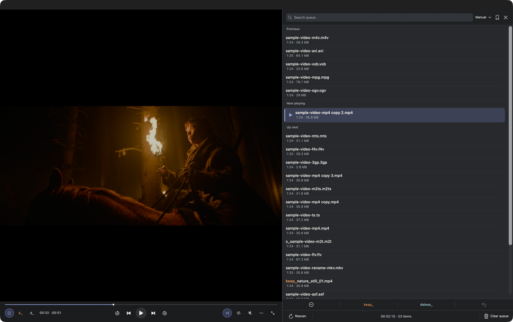

<p align="center">
  
</p>

<h1 align="center">dwb player</h1>

<p align="center">
  A native macOS media player for fast local queueing, multi-window playback, and practical file controls.
</p>

<p align="center">
  
</p>

## Overview

dwb player is a native Swift/AppKit media player for macOS 13 and newer, built for fast local queueing, independent playback windows, and direct file-management controls. Playback is powered by VLCKit.

It is local-only: no streaming, cloud sync, telemetry, transcoding, or media-library management.

> **Current version:** v1.5.3 (build 131). See [CHANGELOG.md](CHANGELOG.md) for what is new.

## Features

**Playback**
- Local video (`mp4`, `m4v`, `mov`, `avi`, `mkv`, `wmv`, `ts`, `mpg`, `ogv`, and more), still images (`jpg`, `png`, `heic`, `webp`, `tiff`, `bmp`), and animated GIFs. Settings controls which types the queue accepts.
- Drag and drop, Finder/Open With, Dock open, and recursive folder import in Finder-style filename order.
- Play/pause, previous/next, configurable skip, scrubber, fullscreen, Fit/Fill/Stretch, Repeat One, Shuffle, and Endless Shuffle.
- Per-window volume (up to 200%), mute, speed, opacity, and a manual audio sync offset for Bluetooth lag.
- Media that cannot be played shows a short message and playback moves on to the next item.

**Queue**
- A Queue Page with search, bookmark filter, sorting (name, size, duration, or manual drag order), multi-select, and total duration.
- Play Next, Reveal in Finder, rename, remove, rescan, and Clear Queue.
- A resizable panel: drag the edge shared with the video; double-click to reset.

**Prefix rename**
- Two configurable filename prefixes for videos, images, and GIFs: by default `N` applies the primary, `M` the secondary, and the same key again removes it. Player and Queue Page buttons do the same, and Command-Z undoes the last change.
- An optional **Advance after prefix** setting plays the next item after a prefix is added.

**Windows and controls**
- Multiple independent player windows, each with its own VLCKit player, and a Command-4 Four Window Grid.
- A unified bottom rail that appears when the mouse moves. A Settings gear opens Settings directly when no actions need overflow; otherwise, More opens a dropdown menu with the overflow actions and Settings.
- **Picture-in-picture style playback.** Turn on Window > Keep Window On Top for a player window, make it small, and it stays above other windows while you work. The setting is per window, so one window can float while others behave normally. Each window plays its own media, with its own volume, speed, and queue.
- Hide Title Bar (Complete Video Mode) and optional titlebar auto-hide. Auto-hide is unavailable while the title bar is hidden, in both Settings and the Window menu.
- A standard Edit menu with Undo, Redo, Cut, Copy, Paste, and Select All for text fields and the rename sheet.
- A Debug Console that keeps recent warnings and errors in memory even when it is closed. Nothing is written to disk.

**Settings and shortcuts**
- Settings has six pages: Playback, Appearance & Controls, Queue & Files, Shortcuts, Advanced, and About.
- Playback speed, window volume, and window opacity apply to one player window, and Settings names the window it controls. Image duration and GIF loops are typed numbers with steppers.
- **Customizable keyboard shortcuts.** Settings > Shortcuts lists every shortcut, with a keyboard map and search. Click a key to change or remove it, add more keys to an action, or assign an unassigned action. Keys that conflict with another action, or that cannot be delivered reliably, are refused. Command-X, C, V, A, Z, and Shift-Command-Z stay reserved for text editing.
- Shortcut changes apply to dwb player only. They update the menus and tooltips, persist across launches, and are cleared by Restore Defaults on the Shortcuts page or by Restore Default Settings on the Advanced page.
- The Advanced page holds the debug console toggle, Clear All Bookmarks, and Restore Default Settings. About shows the version, license, minimum macOS, and the VLCKit and VLC backend versions.

## Screenshots

<p align="center">
  
</p>

<p align="center">
  
</p>

<p align="center">
  
</p>

## Download

Download the app ZIP from the [latest release](https://github.com/dweebzxx/dwb-player/releases/latest), unzip it, and move `dwb player.app` to Applications. The app is not notarized, so macOS blocks the first launch: right-click the app and choose Open, or run `xattr -dr com.apple.quarantine "/Applications/dwb player.app"`.

## Build From Source

Requirements: macOS 13 or newer, Xcode with command line tools, and a Swift 5.9-compatible toolchain. The first build needs network access so Swift Package Manager can fetch the pinned VLCKit package (`vlckit-spm` 3.6.0).

```sh
./scripts/build-app.sh
```

The app is written to `dist/dwb player.app`. To regenerate the Xcode project after editing `dwb/project.yml` (requires `xcodegen`):

```sh
cd dwb && xcodegen generate --spec project.yml && cd ..
```

To create a local ZIP package with a checksum and draft release notes:

```sh
./scripts/package-release.sh
```

## Release and Signing

Each release includes the source code and a built app zip. The built app is ad-hoc signed, not Developer ID signed, notarized, or sandboxed. A fully signed binary release would need Developer ID signing, notarization, and Gatekeeper verification. `./scripts/package-release.sh --check-release-inputs` checks those inputs without signing, notarizing, or uploading anything.

## License

MIT. See [LICENSE](LICENSE). The license covers this app's source code, not VLCKit, libVLC, or other third-party dependencies.
