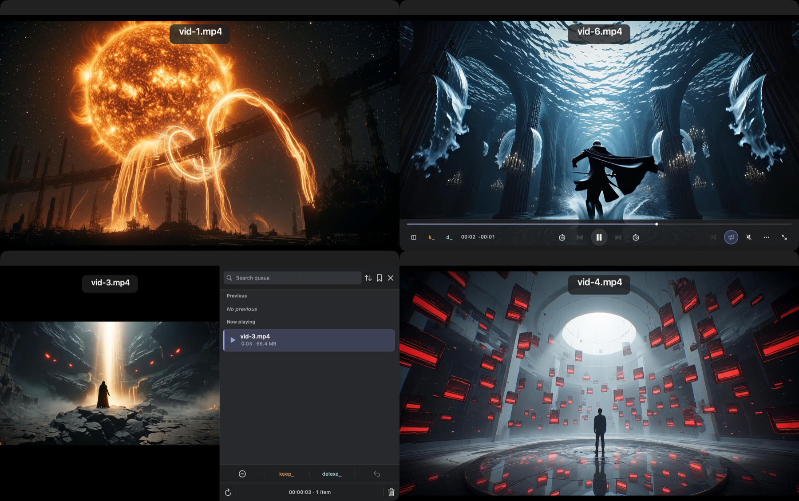
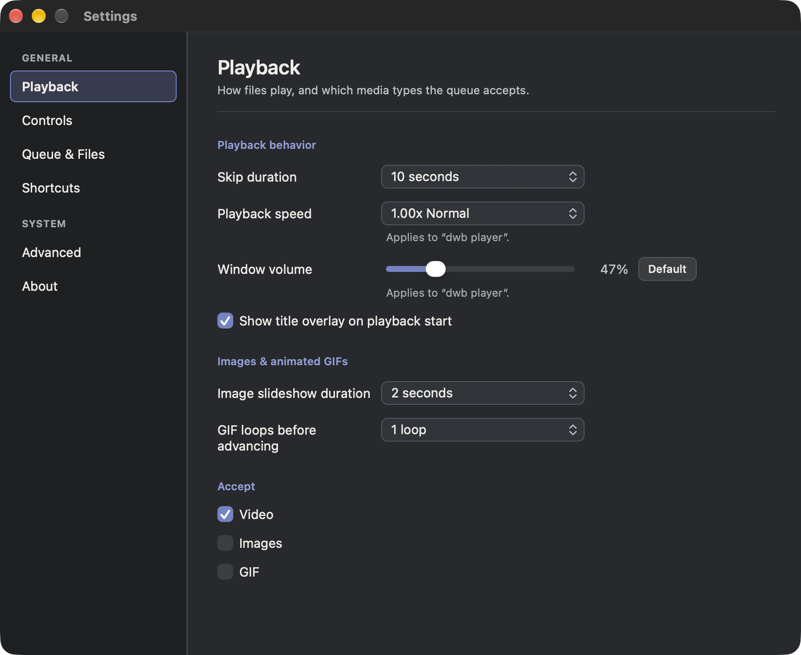

<p align="center">
  
</p>

<h1 align="center">dwb player</h1>

<p align="center">
  A native macOS media player for fast local queueing, multi-window playback, and practical file controls.
</p>

<p align="center">
  
</p>

## Overview

dwb player is a native Swift/AppKit media player for macOS 13 and newer. It is designed for fast local queueing, independent playback windows, Finder-style file ordering, and direct file-management controls.

> **Release status:** The current official version is **v1.5.1**. See [CHANGELOG.md](CHANGELOG.md) for what is new.

Playback is powered by VLCKit through Swift Package Manager. dwb player is local-only: it does not provide streaming, cloud sync, telemetry, transcoding, or media-library management.

## Features

### Playback

- Native Swift and AppKit macOS application with a programmatic UI.
- VLCKit-backed local video playback.
- **New in 1.5.1:** AV1 video is decoded with VLC's bundled libaom decoder.
- Common local video formats: `mp4`, `m4v`, `mov`, `avi`, `flv`, `f4v`, `wmv`, `asf`, `mkv`, `ts`, `mts`, `m2ts`, `m2t`, `mpg`, `3gp`, `3g2`, `vob`, `ogv`, and `ogm`.
- Still-image and animated GIF playback with configurable slideshow duration and GIF loop count. Supported image formats: `jpg`, `jpeg`, `jfif`, `png`, `gif`, `tiff`, `tif`, `bmp`, `heic`, `heif`, and `webp`.
- Still-image slideshow intervals include 0.5 and 0.75 seconds in addition to the existing choices.
- Drag-and-drop, Finder/Open With, Dock open, menu open, and recursive folder expansion for supported local media files.
- Folder import uses Finder-style natural filename ordering by display filename, with deterministic path tie-breaks.
- Top-insert behavior for explicitly opened or dropped files, so new files can be queued quickly.
- Play/pause, previous/next, configurable rewind/forward skip controls, scrubber seeking, fullscreen, Fit/Fill/Stretch scale modes, Keep Window On Top, and optional titlebar auto-hide.
- Per-window volume, mute, playback speed, opacity, and playback state. Persisted volume is used as the default for new windows.
- **New in 1.5.1:** Volume goes up to 200% (100% is normal volume), and one window's volume or mute never changes another window's.
- **New in 1.5.1:** A manual audio sync offset for Bluetooth and other laggy outputs: `[` advances and `]` delays the audio by 50 ms, `\` resets it, and the Playback menu has matching Audio Sync items.
- **New in 1.5.1:** Media that cannot be played shows a one-second message and playback moves on to the next item on its own.
- **New in 1.5.1:** Dropping a folder starts ordinary Shuffle from a randomized item, and clicking the scrubber shows visible progress where you click.
- Repeat One plus a three-state shuffle cycle: Off, Shuffle, and Endless Shuffle.
- Stop isolation, stop-to-Queue-Page flow, paused-near-end completion handling, and queue restart from the beginning after natural completion.

### Queue

- Full Queue Page with filename, duration, file size, search/filter, bookmark filter, and total queue duration.
- Queue search includes a native clear action.
- Manual queue ordering by row drag, plus sort modes for Name A-Z, Name Z-A, Size Low-High, Size High-Low, Duration Short-Long, and Duration Long-Short.
- Name A-Z and Name Z-A sorting use the same Finder-style natural filename comparison as folder import.
- Single-click row selection and double-click-to-play.
- Filtered and bookmarked multi-selection supports Delete, Backspace, and Forward Delete while preserving the intended row and context-menu target.
- Multi-select queue operations, selected-row Delete/Backspace removal, Remove All, Clear Queue, and rescan.
- Queue metadata (duration and file size) stays visible under each filename, while the obsolete Duration and Size visibility toggles have been removed.
- **New in 1.5.1:** Animated GIF durations are read in the background, so opening the Queue Page does not stall on large GIFs.
- **New in 1.5.1:** For files on non-local volumes such as network mounts, the player does not probe durations in bulk; a row shows `--:--` until the file has played.
- **New in 1.5.1:** Right-click a row and choose **Play Next** to play it right after the current item, including while a search filter is active. Repeated Play Next choices form an ordered chain.
- Reveal in Finder and rename current file actions from the app menu or queue context actions.
- Bookmark toggles in the playback controls, queue rows, and Queue Page filter.
- Quick Queue support, including an optional setting to open the Queue Page when a player window opens.
- Filtered-empty recovery actions and safer row rendering.
- **New in 1.5.1:** A compact Queue Page list with one header row and a two-row footer at every width.
- **New in 1.5.1:** In windowed mode, drag the edge the Queue Page shares with the video area to make the panel narrower (down to 200 pt); double-click the edge to return to the default width. The width is not saved between launches.

### Accessibility and Recovery

- Keyboard-focusable rail, Queue, recovery, and Settings controls expose labels, state, and stable automation identifiers. Hidden rail controls are removed from focus and accessibility navigation.
- Unsupported media, unavailable folders, and failed or empty scans are presented as persistent in-window recovery cards that preserve the current queue and playback state.

### Prefix Rename

- Dual configurable prefix rename for videos, images, and GIFs.
- **New in 1.5.1:** The primary prefix is applied with `N`; the secondary prefix is applied with `M`. Pressing the same key again removes that prefix, and pressing the other key replaces it instead of stacking.
- **New in 1.5.1:** **Edit > Undo Prefix Change** (Command-Z) undoes the last prefix change.
- Player and Queue Page prefix buttons can apply the configured prefix without opening a rename dialog. **New in 1.5.1:** Turning off **Prefix buttons** in Settings hides the prefix actions from the bottom rail and its More menu.
- **New in 1.5.1:** Optional **Advance after prefix** setting (off by default): after `N`, `M`, or a rail prefix button adds a prefix to the current item, playback moves on to the next item. Removing a prefix never advances, and the Queue Page's own prefix controls never advance.
- Player and bottom-rail prefix buttons show the first configured character plus `_`; Queue Page footer prefix labels show the trimmed full prefix up to 8 characters, truncating longer labels with an ellipsis.
- Queue highlighting recognizes both prefixes and prefers the longer matching prefix when both could match.
- Prefix identity colors are Dark Teal 500 `#488FA0` for primary and Burnt Orange 300 `#D4906A` for secondary.
- `x_` is only a possible user-configured prefix value; it is not a hard-coded rename mode.

### Windows and Controls

- Multiple independent player windows, each with its own VLCKit player state.
- Command-4 Four Window Grid layout for arranging four player windows.
- Unified bottom rail as the active control surface, with optional transport buttons, auto-hide behavior, bookmark control, prefix controls, and More menu fallback.
- More menu fallback for rail actions that do not fit in the active bottom rail.
- **New in 1.5.1:** The bottom rail appears when the mouse moves inside the player window; keyboard shortcuts do not reveal it.
- **New in 1.5.1:** Closing the last player window keeps the app running in the Dock, and a Dock click restores a minimized window before opening a new one.
- Complete Video Mode for windowed fill playback.
- Window opacity slider from 35% to 100%.
- Responsive rail layouts, a quieter title overlay, and a subtle divider between the video and Queue surfaces.

### Settings, Menus, and About

- Settings window sections: Playback, Controls, Queue & Files, Shortcuts, Advanced, and About.
- Refined Settings and About spacing, terminology, minimum sizing, and form alignment.
- **New in 1.5.1:** A Window volume slider in Settings with a percent readout and a Default button. It controls one window, and the row names which window it targets.
- Configurable skip duration, slideshow duration, GIF loop count, accepted media types, optional playback-bar buttons, Queue Page behavior, rename options, titlebar behavior, Complete Video Mode, rail behavior, playback speed, and window opacity.
- About identifies `dwb player`, shows the app version and build, lists the MIT License, identifies AppKit and VLCKit, and links to the GitHub repository and issue tracker. The primary repository action is labeled **View on GitHub**.
- Programmatic menus cover dwb player, File, Edit, Playback, Video, and Window actions including Settings, Open, Reveal in Finder, Rename, Remove Current from Queue, Clear Queue, New Window, Undo Prefix Change, Copy, Paste, Select All, playback controls, speed, audio sync, scale mode, Four Window Grid, Keep Window On Top, and Auto-hide Titlebar.
- Developer/debugging support through the Debug Console with filtering, snapshots, export, and optional verbose autoplay tracing.
- **New in 1.5.1:** Even with the Debug Console off, the app keeps recent warnings and errors, plus the log lines leading up to them, in memory only (nothing is written to disk), so opening the console afterward shows what happened. A playback start that never reaches the playing state is logged with the file and player state.

## Screenshots

<p align="center">
  
</p>

<p align="center">
  
</p>

<p align="center">
  
</p>

## Requirements

- macOS 13 or newer
- Xcode with command line tools
- Swift 5.9-compatible toolchain
- Network access for Swift Package Manager on first build so Xcode can fetch the pinned VLCKit package and binary artifact recorded in `Package.resolved`
- Optional: `xcodegen` to regenerate `dwb/dwb.xcodeproj` from `dwb/project.yml`

## Build From Source

Build the app from the repository root:

```sh
./scripts/build-app.sh
```

The script builds the `dwb` scheme in Release configuration and copies the app bundle to:

```text
dist/dwb player.app
```

The standard build uses Xcode and Swift Package Manager with the pinned `vlckit-spm` 3.6.0 dependency. Local generated Xcode state under `.tmp/derivedData/` may be cleared when stale absolute package artifact paths are detected after moving the repository. A cached VLCKit products fallback is disabled by default and is only for local development with `DWB_ALLOW_DEV_CACHED_VLCKIT_FALLBACK=1`; it is not release provenance.

It also writes local build metadata to:

```text
dist/dwb-player-app-build-info.txt
```

Create a local ZIP package, checksum, manifest, and draft release notes:

```sh
./scripts/package-release.sh
```

Release packaging artifacts are written under a versioned folder such as `dist/release/dwb-player-<version>/`. The ZIP workflow verifies the built app and extracted app locally, but it does not publish a GitHub Release, upload assets, notarize, staple, tag, or commit anything.

Binary release preparation is separate from local packaging. A future credentialed release pass must provide a Developer ID Application identity, notarytool credentials or profile, explicit notarization upload approval, and final Gatekeeper verification:

```sh
DWB_SIGNING_IDENTITY="Developer ID Application: Example, Inc. (TEAMID)" \
DWB_NOTARY_KEYCHAIN_PROFILE="profile-name" \
DWB_ALLOW_NOTARIZATION_UPLOAD=1 \
./scripts/package-release.sh --release
```

Installer release mode additionally requires a Developer ID Installer identity:

```sh
DWB_SIGNING_IDENTITY="Developer ID Application: Example, Inc. (TEAMID)" \
DWB_INSTALLER_SIGN_IDENTITY="Developer ID Installer: Example, Inc. (TEAMID)" \
DWB_NOTARY_KEYCHAIN_PROFILE="profile-name" \
DWB_ALLOW_NOTARIZATION_UPLOAD=1 \
./scripts/build-installer.sh --release
```

Run the release input checks without signing, packaging, notarizing, or uploading:

```sh
./scripts/package-release.sh --check-release-inputs
./scripts/build-installer.sh --check-release-inputs
```

If `project.yml` changes and you need to regenerate the Xcode project:

```sh
cd dwb
xcodegen generate --spec project.yml
cd ..
./scripts/build-app.sh
```

## Release and Signing

The public release currently provides source code only. It does not publish signed or notarized release downloads, installer packages, App Store builds, or binary release assets. No signed or notarized binary release has been published.

Local source builds and tests do not require Apple Developer Program membership. Local builds are ad-hoc signed for local `codesign` verification by default, but they are not Developer ID signed, notarized, stapled, sandboxed, or Gatekeeper-ready. Public binary release remains optional/deferred and requires Developer ID Application signing with Hardened Runtime, notarization, stapling where applicable, and recorded `spctl` verification of the exact release artifact before publication.

App Sandbox is not adopted yet. It remains a future design decision because local media playback, folder import, persisted local paths, and rename workflows need a deliberate security-scoped bookmark and file-access design before sandboxing can be enabled honestly.

## Project Structure

```text
dwb/
  project.yml
  dwb.xcodeproj/
  dwb/
    App/
    Player/
    Resources/
docs/images/
scripts/
  build-app.sh
  build-installer.sh
  package-release.sh
  sign-app.sh
```

`dist/`, `.tmp/`, `DerivedData/`, build logs, archives, package outputs, signing material, and local user state are intentionally ignored by git.

## License

MIT. See [LICENSE](LICENSE).

This repository's MIT license applies to this app's source code, not to VLCKit, libVLC, or other third-party dependencies.
